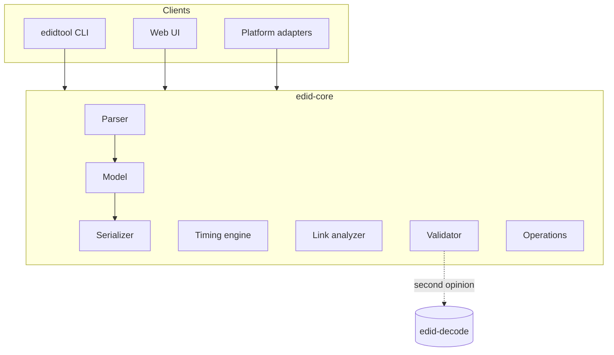

# EDID Studio — Product Spec

Oct 14, 2026 · @Bez

## Overview

EDID Studio is a local-first tool for building, editing, validating and explaining EDIDs, so a GPU negotiates exactly the mode, colour format and bit depth you intend, including non-standard resolutions.

A source (GPU, media server) picks its output from two inputs: the display's EDID and a bandwidth check on the link. When the EDID advertises something the link cannot carry, the driver quietly falls back, usually to 8-bit. Hand-editing hex hides this, and no common tool says why a mode was rejected.

**The case this spec grows from.** A Tessera SX40 behind an Nvidia GPU kept dropping to 8-bit although every device in the chain supported 10-bit. The original EDID listed 23 video modes, a 3840x2160 60 Hz preferred timing and 12-bit deep-colour flags. The EDID that fixed it holds one timing (4000x2220 total, 444 MHz, exactly 50.000 Hz), RGB only, 10-bit only, with no standard VIC entry. Its owner reports it worked. Section 14 records what that case taught.

**Verification rule.** Field layouts and limits in this spec come from working knowledge of VESA E-EDID, CTA-861, HDMI and CVT, and the case study above. Claude Code must check each against the published specs or `edid-decode` before relying on it, and mark anything it cannot confirm as `TODO(verify)`.

## Goals and non-goals

The tool succeeds when an engineer can state a raster, refresh, colour format and bit depth, and get an EDID that a source honours the first time.

**Goals**

- Build a valid EDID from intent: resolution, refresh, colour format, bit depth, link type, device name.
- Edit existing EDIDs with the smallest possible byte change, preserving blocks the tool does not understand.
- Explain, for every advertised mode, whether it fits the link at the advertised format and depth.
- Handle non-standard resolutions with exact refresh, enforced field limits and no silent rounding.
- Make every result reproducible: same input and recipe give the same bytes.
- Record whether each EDID was verified on real hardware.

**Non-goals**

- A display driver, firmware or signal generator. The tool produces data; it does not drive a link.
- A replacement for runtime tools like CRU. Applying an EDID to a live system is a later, guarded feature.
- Cloud features. The library and all processing stay local. The web UI may be served as a public static site, but EDIDs are processed in the visitor's browser and never sent to a server (section 13).

## Users and core workflows

The primary user is an AV, LED or projection engineer who configures sources and processors and needs the EDID to be a deliberate choice, not a guess.

**Typical setup (owner, 2026-10-14).** The user runs an NVIDIA RTX PRO (formerly Quadro) card in a media server or render node, and uses EDID Studio on a separate machine. EDIDs travel as files: exported from the workstation with the NVIDIA Control Panel (Workstation > View system topology > EDID > Export), uploaded or pasted into EDID Studio, edited, downloaded as `.txt` (or another format), copied back, and loaded by hand (EDID > Load, pick connectors, accept the warning). The tool never touches the workstation directly. GeForce cards have no EDID management, so they are out of scope for this route.

1. **Strip down.** Import an EDID, keep only one mode, colour format and bit depth, export. This is the task that started the project.
2. **Build from intent.** Create an EDID for a non-standard raster, for example 3840x1080 at 50 Hz, RGB, 10-bit, over HDMI 2.0, keeping a device's identity and name.
3. **Diagnose.** Import an EDID from a file or a connected display and get a plain-language report of why a driver may choose 8-bit, 4:2:2 or 4:2:0.
4. **Make a set.** Generate EDIDs for several outputs, for example a mosaic, with identical timings and distinct serial numbers.
5. **Record the result.** Mark an EDID as verified or failed on a named device, GPU and driver version, with a note.

## Architecture and tech stack

One pure core library does all EDID work; the CLI, the web UI and platform adapters are thin layers over it.

- **`edid-core`** (TypeScript, strict mode, zero runtime dependencies): parse, model, serialize, timing engine, link analyzer, validator, operations. It runs in Node and in the browser.
- **`edidtool`** CLI (Node): scripting, CI and recipes.
- **Web UI** (React and Vite): a local-first app with the library stored on disk or in IndexedDB. A desktop wrapper (Tauri) is optional and only needed for device I/O.
- **Platform adapters**: Windows registry, Linux sysfs, macOS ioreg. These live in the CLI or desktop layer, never in the core.
- **External oracle**: `edid-decode` run as a subprocess, in CI and optionally at runtime. Check its licence before bundling it.

Two rules keep it reliable. The serializer is the only code that writes EDID bytes, so UI and CLI never build hex themselves. Every operation returns a new model and is re-validated before anything is exported.

TypeScript is recommended so one codebase serves UI and CLI. A Rust core compiled to WASM is a valid alternative; performance is not a factor here.



The CLI, the UI and the adapters call the core; only the validator reaches outside it, to `edid-decode`.

## Data model and file formats

EDIDs are parsed into a typed tree, edited as that tree, and serialized back; unknown blocks are carried through as opaque bytes so nothing is lost.

The tree holds a base block (identity, version, input definition, chromaticity, established and standard timings, four 18-byte descriptors) and a list of extension blocks. Each CTA-861 extension holds data blocks and optional detailed timings. Anything unrecognised is stored verbatim and re-emitted unchanged.

| Block | Release | Notes |
| --- | --- | --- |
| Base block, EDID 1.3 and 1.4 | MVP | Full edit |
| Detailed timing descriptor (DTD) | MVP | Field limits enforced (section 6) |
| Monitor name, range limits, serial, ASCII, dummy descriptors | MVP | Name is 13 characters maximum |
| Established and standard timings | MVP | Standard timings are 8-pixel granular |
| CTA-861 extension, revision 3 | MVP | Header flags, data blocks, DTD offset and padding |
| Video data block (SVD) | MVP | VIC lookup table included |
| HDMI VSDB (OUI 00-0C-03, stored 03 0C 00) | MVP | Deep-colour flags, max TMDS, HDMI VICs |
| HDMI Forum VSDB (OUI C4-5D-D8, stored D8 5D C4) | MVP | Max TMDS rate, SCDC, 4:2:0 deep colour |
| Video capability, 4:2:0 capability map, 4:2:0 video data block | MVP | SVD indices re-mapped on edit |
| Audio, speaker allocation, colorimetry, HDR static metadata | v1 | Parsed in MVP, editable in v1 |
| HDMI Forum SCDB (FRL, DSC) | v1.1 | Needed for HDMI 2.1 targets |
| DisplayID Type I and VII timings, CTA video timing, video format preference | v1.1 | For timings a DTD cannot hold |
| Unknown blocks | MVP | Preserved byte for byte |

**Import:** hex text in any common layout (spaces, commas, `0x` prefixes, offset dumps), binary, C array, base64, Windows `.reg` override, and live read (section 13).

**Export:** hex text in the same style as the input, binary, C array, base64, `.reg` override, JSON model.

Every export asserts that its length is 128 x (1 + extension count) and that every block checksum sums to zero. An export that fails either check is refused.

## Timing engine

The timing engine turns "width x height at a refresh rate" into an exact, encodable timing, or says precisely why it cannot.

**Inputs:** active size; refresh as a rational (50, or 60000/1001 for 59.94); interlace; a formula (CTA-861 VIC lookup, VESA DMT lookup, CVT, CVT-RB v1/v2/v3, GTF, or manual porches and sync); and an exact-refresh switch.

**Outputs:** pixel clock in 10 kHz units; horizontal and vertical active, front porch, sync, back porch and polarity; the achieved refresh as a rational with its error in ppm; and an encodings list saying whether the timing fits a DTD, matches a VIC, or needs a DisplayID block.

**Exact-refresh solver.** A DTD pixel clock is a whole number of 10 kHz steps, so refresh = clock / (htotal x vtotal) lands on the target only for some totals. The solver searches htotal (multiples of 8 first, then 2, then any) and vtotal within the formula's minimum blanking plus a configurable slack, keeps only combinations where the clock is a whole number of steps, and ranks them by closeness to the chosen formula. In the case study, 4000 x 2220 x 50 Hz gives exactly 444.000 MHz. CVT-RB v1 rounds its clock down and would give 442.00 MHz, about 49.98 Hz, which can drop frames against a genlocked 50.000 Hz system. For fractional rates an exact hit is usually impossible; the tool reports the ppm error and never rounds silently.

**DTD field limits.** The encoder must refuse, with the field named, anything that overflows:

| Field | Bits | Maximum |
| --- | --- | --- |
| Pixel clock (10 kHz units) | 16 | 655.35 MHz |
| Horizontal active, horizontal blanking | 12 each | 4095 |
| Horizontal front porch, horizontal sync width | 10 each | 1023 |
| Vertical active, vertical blanking | 12 each | 4095 |
| Vertical front porch, vertical sync width | 6 each | 63 |
| Image size, each axis (mm) | 12 | 4095 (0 = unspecified) |

This is why the standard 4K50 timing (VIC 96, front porch 1056) cannot be a DTD. The engine reports "DTD: no, front porch 1056 exceeds 1023; VIC 96: yes" and offers a reduced-blanking alternative.

**Rules for non-standard rasters** (for example 3840x1080, 2688x1536, 7680x1080):

- Warn when active width is not a multiple of 8. Error when width or height is odd and a subsampled format (4:2:2, 4:2:0) is selected.
- Default polarity by formula: CVT normal H- V+, CVT-RB H+ V-, CTA per its VIC table.
- For HDMI targets, warn when horizontal blanking is under 160 pixels. This is a heuristic, configurable, not a spec constant; variants with 80-pixel blanking are not generally HDMI-safe.
- If the clock exceeds 655.35 MHz, propose a reduced-blanking formula, a DisplayID timing (v1.1), or a lower refresh or size.
- Never invent image size. Leave 0 unless the user gives millimetres or a diagonal.

**Reference data.** Ship the full CTA-861 VIC and VESA DMT tables as data files, and generate known-answer tests from the `cvt` and `gtf` utilities and `edid-decode`.

## Link budget and format feasibility

For every advertised mode the analyzer answers one question: at this colour format and bit depth, does it fit the link, and what will a source pick?

The rule behind the case study: the link carries blanking, so load is total pixels per second times bits per pixel, not visible pixels. At 4K50 with CEA timing the visible-pixel maths looks fine, but the link needs 594 MHz of clock.

| Format | TMDS character rate |
| --- | --- |
| RGB, YCbCr 4:4:4 | pixel clock x bit depth / 8 |
| YCbCr 4:2:2 | pixel clock (12-bit container at every depth) |
| YCbCr 4:2:0 | pixel clock / 2 x bit depth / 8 |

| Link | Limit |
| --- | --- |
| DVI single link | 165 MHz clock |
| HDMI 1.4 | 340 MHz TMDS character rate |
| HDMI 2.0 | 600 MHz (18 Gbps raw, 14.4 Gbps payload, 8b/10b) |
| HDMI 2.1 FRL | 9, 18, 24, 32, 40, 48 Gbps (3x3, 6x3, 6x4, 8x4, 10x4, 12x4 Gbps lanes), 16b/18b |
| DisplayPort 1.2 (HBR2) | 21.6 Gbps raw, 17.28 payload |
| DisplayPort 1.4 (HBR3) | 32.4 Gbps raw, 25.92 payload |
| DisplayPort 2.x (UHBR10, 13.5, 20) | 40, 54, 80 Gbps raw, 128b/132b |

Worked example from the case, HDMI 2.0:

| Timing | Pixel clock (MHz) | Format and depth | TMDS rate (MHz) | Fits 600 MHz |
| --- | --- | --- | --- | --- |
| 4K60, CEA | 594 | RGB 10-bit | 742.5 | No |
| 4K50, CEA (VIC 96) | 594 | RGB 10-bit | 742.5 | No |
| 4K50, 4000x2220 total | 444 | RGB 10-bit | 555 | Yes |
| 4K50, CEA | 594 | 4:2:2 10-bit | 594 | Yes |
| 4K50, CEA | 594 | 4:2:0 10-bit | 371.25 | Yes |

**Output.** A matrix of mode x format x depth with a verdict and the numbers behind it, for a link type the user selects in the project.

**Likely driver choice.** A labelled heuristic, not a spec: prefer RGB, then 4:4:4, 4:2:2, 4:2:0, at the highest depth that fits both the EDID flags and the link. Observed Nvidia behaviour is recorded as notes, never as rules.

**Contradiction warnings.** Flag any EDID that advertises a capability no listed mode can use, for example 10-bit RGB flags when every RGB mode exceeds the link, or YCbCr 4:4:4 deep colour without the 4:4:4 support flag.

## Validation and reliability

Nothing is exported unless it passes three rule tiers, an independent decoder and a round-trip.

**Tier 1, structural (errors).** Header bytes, every checksum, block lengths, DTD offset, extension count, reserved bits, descriptor tags, printable ASCII in text fields.

**Tier 2, semantic (errors and warnings).**

- The first descriptor is a DTD whenever the preferred-timing bit is set.
- Range limits cover every timing: vertical Hz, horizontal kHz, and a max pixel clock rounded up to a multiple of 10 MHz unless set manually.
- Every SVD is a known VIC; the 4:2:0 capability map never has more bits than SVDs.
- The HDMI VSDB length covers every field it sets; max TMDS is at least the highest advertised mode.
- The HDMI Forum VSDB is present, with SCDC set, for any mode above 340 MHz TMDS.
- Deep-colour flags agree with the CTA header flags (for example DC\_Y444 without YCbCr 4:4:4 is an error).
- Standard timings decode exactly; bit depth in the base block is used only on EDID 1.4.

**Tier 3, link feasibility (warnings).** The analyzer from section 7, including contradiction warnings.

Every rule has a stable ID, a severity, a plain-language explanation and, where safe, an automatic fix. A rule without a test is not merged.

**Independent checks**

- `edid-decode --check` runs in CI on every golden output and is available as a "second opinion" in the UI and CLI. Any disagreement is triaged as a bug, never suppressed.
- Round-trip: parse, model, serialize gives identical bytes for every fixture, unknown blocks included.
- Property tests: random valid timings build, parse and compare equal; every DTD field is tested at its limit and limit + 1; checksums always sum to zero; length is always a multiple of 128.
- Known-answer tests: all CTA VICs, DMT modes, CVT and GTF against reference tools, link budgets against the hand-checked cases in section 7.
- Golden recipes: section 15.
- Hardware verification records: section 11 and 14.

## Operations and recipes

Every edit is a pure operation on the model and is logged in a recipe, so any result can be reproduced, reviewed and shared as JSON.

| Operation | Effect |
| --- | --- |
| `keepOnlyModes` | Removes all other video modes: DTDs, standard and established timings, SVDs, HDMI VICs, 4:2:0 map entries (indices re-mapped), and an empty video data block |
| `setPreferredTiming` | Builds a timing with the engine and places it in the first descriptor |
| `addMode`, `removeMode` | Edit the mode list; each mode is stored in the best available encoding |
| `setColor` | Sets formats and depths together: CTA header flags, HDMI VSDB deep-colour bits, HDMI Forum VSDB 4:2:0 bits, base-block depth on EDID 1.4 |
| `setRangeLimits` | `auto` from the modes, or manual V, H, max clock and GTF flag |
| `setIdentity` | Manufacturer ID, product code, serial, name, week and year |
| `setHdmiCaps` | Max TMDS, SCDC, physical address |
| `setAudio`, `stripAudio` | Audio and speaker blocks |
| `setSerial` | Per-output serial for sets |

Each operation checks its preconditions, runs the validator afterwards and returns a plain-language diff. The recipe below reproduces the case-study EDID from the original; it is also acceptance test 1.

```json
{
  "recipe": 1,
  "base": { "file": "Tessera-EJE-test.txt" },
  "ops": [
    { "op": "keepOnlyModes", "modes": [] },
    { "op": "setPreferredTiming", "width": 3840, "height": 2160, "refresh": "50",
      "formula": "exact-refresh", "hBlank": 160, "vBlankLines": 60,
      "hFrontPorch": 48, "hSync": 32, "vFrontPorch": 8, "vSync": 10,
      "polarity": "H+V-" },
    { "op": "setColor", "formats": ["rgb"], "depths": [10] },
    { "op": "setRangeLimits", "vHz": [50, 50], "hKHz": [110, 113],
      "maxClockMHz": 600, "gtf": "none" }
  ],
  "expect": {
    "bytes": 256,
    "dtd": "70 ad 00 a0 f0 70 3c 80 30 20 8a 00 00 00 00 00 00 1a",
    "checksums": ["bf", "d6"]
  }
}
```

Recipes are the unit of sharing and review. The UI shows the same list as an editable history; the CLI runs it with `edidtool recipe run`.

## Features by release

The MVP is the core library, CLI and recipes; the UI follows once the engine is trusted.

| Release | Scope |
| --- | --- |
| MVP | Parse and serialize base and CTA blocks with unknown-block preservation; hex, binary, C array, base64 and `.reg` import and export; tier 1 and 2 validation; timing engine with exact-refresh solver and DTD limits; VIC and DMT tables; link analyzer for HDMI 1.4, 2.0 and DisplayPort; operations and recipes; CLI; golden-recipe test; library as plain files with JSON sidecars |
| v1 | Web UI (editor, wizard, timing lab, compare, export); audio, colorimetry and HDR editing; multi-output sets; hardware verification records; read EDIDs from Windows, Linux and macOS |
| v1.1 | DisplayID Type I and VII timings and CTA video timing blocks; HDMI Forum SCDB (FRL, DSC) and HDMI 2.1 link rules; EDID 1.4 base features; video format preference block |
| Later | Guarded apply to Windows (EDID override with backup and rollback); programming EDID emulators over DDC; device profile plugins (for example Tessera) |

## UI specification

The UI never shows a green state while any error exists, and every warning explains itself in plain language.

| Screen | Purpose | Key behaviour |
| --- | --- | --- |
| Library | Browse saved EDIDs | Filter by device, tag, verified status; badge shows "verified on \<device, GPU, driver>" or "failed" with the note |
| Editor | Inspect and edit one EDID | Left: structure tree with issue badges. Centre: hex view where hovering a field highlights its bytes and editing a field rewrites them live; bytes changed from the original are marked. Right: inspector and an Issues panel grouped by severity, click to jump, fix buttons |
| New from intent | Guided creation | Steps: target device or free; raster and refresh with an exact-refresh preview; colour format and depth with an instant feasibility meter; identity and export |
| Timing lab | Calculator | Inputs for active size, porches, sync, polarity, formula. Live: pixel clock, achieved refresh and ppm error, DTD field-limit gauges, and link meters per format and depth against each link type |
| Compare | Semantic diff | Modes added or removed, flags changed, identity changes, then the byte diff |
| Export | Output | Format picker, exact preview, verification results (rules and `edid-decode`), copy and download |

Design requirements: keyboard-first editing, dark and light themes, works offline, no network calls, and the recipe history is always visible and editable.

## CLI specification

The CLI exposes every core function, prints human text by default and JSON with `--json`, and reports problems through its exit code.

```bash
edidtool decode  <file> [--json]
edidtool validate <file> [--link hdmi2.0] [--strict] [--second-opinion]
edidtool timing  --width 3840 --height 2160 --refresh 50 --formula exact \
                 --hblank 160 --vblank-lines 60 --explain
edidtool budget  --timing 3840x2160@50 --formula cvt-rb --color rgb --depth 10 --link hdmi2.0
edidtool build   --base original.txt --width 3840 --height 2160 --refresh 50 \
                 --color rgb --depth 10 --link hdmi2.0 --name "Tessera SX40" -o out.txt
edidtool recipe run recipe.json -o out.txt
edidtool diff    a.txt b.txt
edidtool convert in.txt --to bin|hex|c|base64|reg
edidtool read    [--display <id>]          # v1, platform adapters
edidtool apply   <file> --display <id>     # later, guarded (section 13)
```

| Exit code | Meaning |
| --- | --- |
| 0 | Clean, no warnings |
| 1 | Warnings only |
| 2 | Errors found; nothing was written |
| 3 | Usage or I/O error |

Output files are never overwritten without `--force`. Hex output mirrors the style of the input file unless `--style` says otherwise.

## Platform integration and safety

The tool reads freely but writes to a system only after an explicit, previewed confirmation with a backup already stored.

- **Primary delivery: download, then load in the NVIDIA app.** Export produces a file the user carries to the workstation (section 3). The NVIDIA Control Panel accepts any file extension as long as the contents are a VESA EDID, and exports EDIDs as hex text in a `.txt` file. The exact text layout NVIDIA writes and the layouts it accepts are `TODO(verify)` against a real export (the Tessera fixtures are believed to be NVIDIA exports). Until verified, hex export mirrors the layout of the imported file, so a round trip through EDID Studio keeps NVIDIA's own layout. The export dialog shows the load steps and advises a reboot (or display re-plug) after loading, since the driver caches EDIDs. Linux workstations use the driver's `CustomEDID` X option with a file path (`TODO(verify)` accepted formats).
- **Download names:** file names are built from the EDID's monitor name, which is untrusted text. They are reduced to letters, digits, `-`, `_` and `.`, kept short, and never a Windows reserved name (`CON`, `NUL`, `COM1` and so on).
- **Read (optional, lower priority):** the tool usually runs on a different machine from the GPU, so live read is a convenience, not a workflow. Windows registry EDID values under the display's device parameters, Linux `/sys/class/drm/*/edid`, macOS `ioreg`. Read-only, no elevation.
- **Apply (later release, optional; the NVIDIA Control Panel load covers the main route):** every write shows the exact diff, stores the original EDID in the library first, and states how to roll back. Windows uses the EDID override mechanism that CRU uses (`TODO(verify)` key and format); Linux uses `drm.edid_firmware` with a file under the firmware directory. Neither is attempted without admin rights and a restart notice.
- **Driver caches:** GPU drivers cache EDIDs. The apply flow lists the steps needed to make a driver re-read them, and a verification step re-reads the live EDID and compares it byte for byte.
- **Hardware targets:** most processors and EDID emulators take `.bin` or hex text. Device profiles record which format each device accepts. The first profile is "NVIDIA Control Panel (RTX PRO / Quadro)": hex text, `.txt`.
- **Privacy:** EDIDs contain serial numbers. The library is local; the export dialog offers to scrub the serial.
- **Identity:** manufacturer and product IDs are editable. The UI marks EDIDs whose IDs are unchanged from their source so a copy is never mistaken for an original.
- **Process safety:** external tools run with argument arrays, never shell strings; dependencies are pinned.
- **Untrusted input:** EDIDs arrive as an uploaded file or a pasted block (owner decision, 2026-10-14), and the UI may be published as a public site, so every input is hostile until checked. The core enforces, before and during parsing:
  - a 512 KiB cap on any file or paste, and a 32 KiB cap (256 blocks) on decoded bytes;
  - upload names: 1 to 255 characters, no path separators or control characters, extension one of `.bin .edid .dat .raw .txt .hex .h .c` or none;
  - content sniffing: common non-EDID types (images, PDFs, archives, executables) are named and refused, and text must be printable ASCII, UTF-8 or UTF-16;
  - linear-time parsing with no unbounded regular expressions, so a crafted paste cannot hang the page;
  - error messages that never echo raw input: tokens are escaped and cut short;
  - every failure is a typed `EdidParseError`, never a crash; a seeded fuzz test enforces this on random and corrupted input.
- **Public deployment (M4):** the site is static, processes EDIDs only in the browser, and makes no network calls after load. It serves a strict Content Security Policy (`default-src 'self'`, no inline script, no `eval`), `X-Content-Type-Options: nosniff` and `Referrer-Policy: no-referrer`. EDID text fields (names, serials) are untrusted and are inserted only as text, never as HTML. Uploaded files are never stored server-side; the browser library (IndexedDB) stays on the visitor's machine.

## Lessons learned and reference fixtures

Six findings from the Tessera SX40 case drive the design; each is labelled by how well it is established.

1. **Blanking counts (verified by arithmetic).** 4K50 CEA timing needs 742.5 MHz of TMDS clock for 10-bit RGB, above HDMI 2.0's 600 MHz. The same raster with 160-pixel horizontal blanking needs 555 MHz.
2. **A DTD cannot hold VIC 96 (verified by field widths).** Its front porch is 1056 and the field stops at 1023, so the standard 4K50 timing exists only as a VIC.
3. **Bit depth lives in the HDMI blocks (verified from the file).** The source EDID is version 1.3, where the base block has no bit-depth field; 10-bit is signalled in the HDMI VSDB and HDMI Forum VSDB.
4. **Unwanted depths should be removed explicitly (observed).** Leaving 12-bit flags in place gives a driver room to choose them.
5. **Removing the standard VIC fixed it (observed, mechanism unconfirmed).** With only the reduced-blanking timing left, the owner's setup worked. Hypothesis: the driver, once a mosaic was configured, chose the standard timing, which cannot carry 10-bit RGB. This must stay labelled a hypothesis until tested.
6. **Hand-copied hex failed (process).** Copying hex by hand produced files of 335, 258 and 255 bytes before a correct 256-byte one. All files must be produced by code and length-checked.

Reference fixtures, supplied by the owner, go in `tests/fixtures/`:

| Fixture | Status | Contents | Checksums (base / ext) |
| --- | --- | --- | --- |
| `Tessera-EJE-test.txt` | Original; 10-bit fell back to 8-bit | 4K60 DTD at 594 MHz, 23 VICs, 12-bit flags, 4:2:0 map | 32 / 2c |
| `Tessera-EJE-4K50-10bit.txt` | First rebuild; not confirmed | 4K50 reduced-blanking DTD plus VIC 96, YCbCr allowed, 10-bit | bf / 05 |
| `Tessera-EJE-4K50-10bit-RGB.txt` | Reported working | 4K50 reduced-blanking DTD only, RGB only, 10-bit only | bf / d6 |

## Acceptance tests

The MVP is accepted when these nine tests pass in CI.

1. **Reproduce the fix.** Running the section 9 recipe on `Tessera-EJE-test.txt` gives output byte-identical to `Tessera-EJE-4K50-10bit-RGB.txt`.
2. **Explain the failure.** `validate` on the original warns that 10-bit RGB needs 742.5 MHz at the 594 MHz timing, above the 600 MHz HDMI 2.0 limit, and lists the formats that do fit (4:2:2 and 4:2:0).
3. **Exact refresh.** `timing` with a 160-pixel horizontal blank and 60 vertical blank lines for 3840x2160 at 50 Hz returns a 4000 x 2220 total, 444.000 MHz, 50.0000 Hz, error 0 ppm.
4. **Refuse the impossible.** Encoding VIC 96 as a DTD fails with the message "horizontal front porch 1056 exceeds 1023" and offers a reduced-blanking alternative and the VIC route.
5. **Round-trip.** Every fixture parses and serializes to identical bytes.
6. **Boundaries.** Property tests pass with each DTD field at its maximum and maximum + 1.
7. **Second opinion.** `edid-decode --check` reports no errors on every golden output.
8. **Length guard.** An export whose length is not 128 x (1 + extensions), or whose checksum is non-zero, is refused. A test feeds a truncated 255-byte file.
9. **Honest rounding.** A 59.94 Hz request reports its ppm error and never presents the result as exact.

## Milestones and Claude Code working agreement

Build in this order, one milestone per pull request; a milestone is done only when its test gate passes. Owner decision (2026-10-14): after M0, start the web UI before M1 to M3. Its first slice (open, editor, export, strip-down edits) uses only what the core already has; screens that need validation, the timing engine or the link analyzer wait for those milestones.

| Milestone | Scope | Done when |
| --- | --- | --- |
| M0 Foundations | Repo, strict TypeScript, fixtures, hex import and export, base and CTA parse and serialize | Acceptance tests 5 and 8 pass |
| M1 Validation | Tier 1 and 2 rule engine, rule IDs, `edid-decode` in CI | Every rule has a test; acceptance test 7 passes |
| M2 Timing and link | Timing engine, DTD limits, exact-refresh solver, VIC and DMT tables, link analyzer | Acceptance tests 2, 3, 4, 6, 9 pass |
| M3 CLI and recipes | All CLI commands, operations, recipe runner | Acceptance test 1 passes |
| M4 Web UI | Library, editor, wizard, timing lab, compare, export | Every screen in section 11 works offline |
| M5 Platform I/O (optional) | Read adapters, then guarded Windows and Linux apply. Deprioritised: users load EDIDs through the NVIDIA Control Panel on a separate machine | Apply backs up, previews and verifies by re-reading |
| M6 v1.1 formats | DisplayID, HDMI Forum SCDB, HDMI 2.1 rules | Fixtures for each new block round-trip |

Save the block below as `CLAUDE.md` in the repo root, with this document as `SPEC.md`.

```markdown
# EDID Studio: rules for Claude Code

- Read SPEC.md first. Build in milestone order, one milestone per PR.
- The serializer is the only code that produces EDID bytes. Never write or edit hex by hand.
- Every exported EDID must validate with no errors, round-trip identically, and have length 128 x (1 + extension count).
- Write the test first for every rule, operation and timing case.
- Do not guess field layouts. Check them against the published specs, `edid-decode` source and Linux drm_edid.c; cite the clause in a comment. If a spec is needed, ask me for it.
- Mark anything unconfirmed as TODO(verify).
- Commands: `pnpm test`, `pnpm lint`, `pnpm typecheck`, `pnpm cli -- <args>`.
- Ask before adding a runtime dependency.
```

## Open questions

Five answers from the owner would settle the remaining design choices. Answers recorded 2026-10-14.

- [x] Primary OS, and how do EDIDs reach the hardware: file upload to the processor or emulator, a Windows override, or both?
  **Answer:** Linux and Windows; the macOS adapter is lower priority. Users bring EDIDs in by uploading a file or pasting a block, and the UI may become a public site (section 13, untrusted input). Finished EDIDs are downloaded (usually `.txt`) and loaded by hand through the NVIDIA Control Panel on an RTX PRO / Quadro workstation, typically a separate machine (section 13).
- [x] Which links matter first: HDMI 2.0 only, or also HDMI 2.1 FRL and DisplayPort?
  **Answer:** HDMI 2.0 first. DisplayPort and HDMI 2.1 FRL follow after it.
- [x] Build order: CLI first as specified, or the web UI first?
  **Answer:** CLI first, as specified.
- [ ] Which devices need presets, and which file formats does each accept?
  **Partial answer:** the NVIDIA Control Panel on RTX PRO / Quadro cards comes first (hex `.txt`). Its exact text layout needs a real NVIDIA export to confirm. Other processors and emulators are still open.
- [ ] Do you want multi-output sets (for example a mosaic) with distinct serials in the MVP rather than v1?
